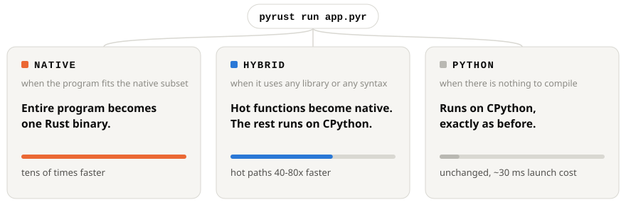
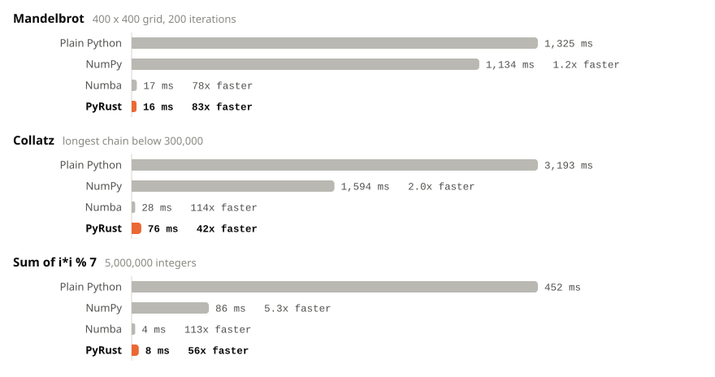

<p align="center">
  <picture>
    <source media="(prefers-color-scheme: dark)" srcset="assets/banner-dark.svg">
    <source media="(prefers-color-scheme: light)" srcset="assets/banner-light.svg">
    
  </picture>
</p>

<p align="center">
  <a href="#quick-start">Quick start</a>
  &nbsp;&#183;&nbsp;
  <a href="#how-it-works">How it works</a>
  &nbsp;&#183;&nbsp;
  <a href="#benchmarks">Benchmarks</a>
  &nbsp;&#183;&nbsp;
  <a href="#what-compiles">What compiles</a>
  &nbsp;&#183;&nbsp;
  <a href="#when-pyrust-will-not-help">When it won't help</a>
  &nbsp;&#183;&nbsp;
  <a href="#faq">FAQ</a>
</p>

<p align="center">
  
  
  
  
  
</p>

**PyRust runs ordinary Python and compiles the parts it can to native code through Rust.**
No decorators, no type annotations, no new syntax. If a program, or part of one, can't be compiled, it runs on
regular Python instead, with the same output. Nothing you already have stops working.

```console
$ pyrust check mixed_app.pyr
Whole-program native compile is blocked: import 'collections' has no native Rust equivalent, so it runs on CPython
Tier: HYBRID - runs on CPython with 1 native function(s):
  native  collatz_steps(int) -> int

$ python mixed_app.pyr          # 6.2 seconds
$ pyrust run mixed_app.pyr      # 0.7 seconds, identical output
most common chain length: 81 steps (6202 numbers)
longest chain: 448 steps
```

That script ([`examples/hybrid/mixed_app.pyr`](examples/hybrid/mixed_app.pyr)) imports `collections` and `re` and
uses `try/except`. PyRust found the one hot function, compiled it, and left everything else alone.

## Highlights

- **One-letter migration.** Rename `app.py` to `app.pyr`, or just point `pyrust run` at the `.py` file.
- **Never breaks a program.** Anything PyRust can't compile runs on CPython: every library, every language feature.
- **Same answers as Python.** Native code reproduces CPython's output, formatting and exceptions; anything it
  cannot reproduce exactly (from 64-bit overflow to shared mutable objects) is handed back to CPython.
- **No annotations required.** Types are inferred from how you use your values. Hints like `n: int` help but are optional.
- **Tells you what it did.** `pyrust check` lists which functions went native and why the others didn't.
- **Zero Python dependencies.** Rust is only needed to compile; without it, programs still run on CPython.

## Quick start

PyRust needs Python 3.11 or newer. Install [Rust](https://rustup.rs) to unlock native speed.

```console
$ git clone https://github.com/shotgun84/pyrust
$ cd pyrust
$ pip install .
$ pyrust doctor                 # confirms Python and Rust are found
```

Then run something:

```console
$ pyrust run examples/bench_cpu.pyr           # whole program compiles: native tier
$ pyrust run examples/hybrid/mixed_app.pyr    # one function compiles: hybrid tier
$ pyrust check your_script.py                 # what would happen to your own code
```

The first run of a program compiles it (a few seconds). Later runs reuse the cached build until the file changes.

| Command | What it does |
|---|---|
| `pyrust run app.pyr [args]` | Run on the fastest tier available. `-q` hides the one-line tier note. |
| `pyrust check app.pyr` | Report the tier, the functions that go native, and the reason for each one that doesn't. |
| `pyrust build app.pyr -o out/` | Produce a standalone native binary (fully native programs only). |
| `pyrust run --native-only app.pyr` | Fail instead of falling back, for when you need the whole program native. |
| `pyrust transpile app.pyr --stdout` | Print the generated Rust. |
| `pyrust migrate project/` | Copy every `.py` in a folder to `.pyr`. |

## How it works

<p align="center">
  <picture>
    <source media="(prefers-color-scheme: dark)" srcset="assets/tiers-dark.svg">
    <source media="(prefers-color-scheme: light)" srcset="assets/tiers-light.svg">
    
  </picture>
</p>

`pyrust run` tries three tiers in order and uses the first that works.

1. **Native.** PyRust infers a concrete type for every value, translates the whole program to Rust, and builds one
   binary. Values that change type at runtime (including a variable that is an `int` on one path and a `float` on
   another) become a small tagged union instead of failing. Rust stores lists, dicts and objects by value where
   Python shares them, so an alias analysis checks that this sharing is never observable: modifying a list passed
   to a function, a row of a grid or an object inside a list works natively; a program where two names could see
   one object change runs on CPython instead.
2. **Hybrid.** When the program as a whole can't be translated, PyRust looks for top-level functions that are *pure*:
   no I/O, no global state, calling only `math`, pure builtins and each other, with `int`/`float`/`bool` arguments
   and results, and containing a loop or recursion (anything smaller isn't worth the trip into native code).
   Those are compiled into a native library and swapped in while CPython runs the rest. Inside such a
   function you can still use lists, dicts, strings, loops and recursion.
3. **Python.** If nothing qualifies, the program runs on CPython unchanged.

### Why the hybrid tier is safe

A native function is only ever a fast path in front of your original function:

- Every call checks the argument types. A call that doesn't match a compiled signature goes to the original.
  When call sites use different signatures (say `int` and `float`), each gets its own compiled version.
- Every call also checks that the globals, builtins and `math` attributes the native code depends on are still the
  objects it was compiled against. If your program rebinds one (`from settings import *`, `globals()[...] = ...`,
  monkeypatching), or calls the function before something it uses is defined, the original runs and behaves
  exactly as Python does, `NameError` included.
- If native code hits something Python handles differently (an integer leaving the 64-bit range, a zero divisor,
  a `math` domain error, a bad index, deep recursion), it reports failure and the original Python function runs.
- Only pure functions are compiled, so running one a second time has no side effects.

```python
def factorial(n):
    return 1 if n <= 1 else n * factorial(n - 1)

factorial(20)    # native: 2432902008176640000
factorial(30)    # overflows 64 bits, so Python computes it: 265252859812191058636308480000000
factorial(5.0)   # wrong type for the compiled version, so Python computes it: 120.0
```

## Benchmarks

<p align="center">
  <picture>
    <source media="(prefers-color-scheme: dark)" srcset="assets/bench-dark.svg">
    <source media="(prefers-color-scheme: light)" srcset="assets/bench-light.svg">
    
  </picture>
</p>

<p align="center">
  <i>One file, three loop-heavy functions, timed inside the running program. Shorter is faster.</i>
</p>

The same file ([`benchmarks/numpy_vs_hybrid.py`](benchmarks/numpy_vs_hybrid.py)) is run with `python` and with
`pyrust run`. It imports NumPy, so it lands in the hybrid tier. All four approaches return identical results.

Read these numbers with care:

- **These workloads suit PyRust.** They are loops with per-element branching. For whole-array maths such as matrix
  multiplication, linear algebra, FFTs or a plain `a.sum()`, NumPy calls tuned native libraries, and PyRust leaves
  that code alone.
- **The NumPy versions are reasonable, not expert-tuned.**
- **Numba is ahead on two of three.** PyRust keeps Python's exact integer behaviour (overflow checks, Python-style
  `%` and `//`), which costs some speed.
- **One machine, best of three runs.** AMD Ryzen 5 3400G, Windows 10, CPython 3.11.9, NumPy 2.4.6, Numba 0.66.0,
  rustc 1.99.1.

Whole programs, measured end to end from the command line (build already cached):

| Program | `python` | `pyrust run` | |
|---|---:|---:|---|
| [`bench_evenodd.pyr`](examples/bench_evenodd.pyr) (native tier) | 5.2 s | 0.3 s | **17x faster** |
| [`bench_cpu.pyr`](examples/bench_cpu.pyr) (native tier) | 2.3 s | 0.3 s | **8x faster** |
| [`mixed_app.pyr`](examples/hybrid/mixed_app.pyr) (hybrid tier) | 6.2 s | 0.7 s | **8x faster** |
| [`fibonacci.pyr`](examples/fibonacci.pyr) (native tier, finishes instantly) | 0.17 s | 0.25 s | slower |

The last row is there on purpose: a script that finishes in a fraction of a second has nothing to speed up, and the
launcher adds a little. For the native-tier rows, most of the 0.3 s is start-up; the binary from `pyrust build`
runs the same work in about 0.1 s.

## What compiles

The native tier accepts a subset of Python. Everything outside it still runs, through the hybrid or Python tier.

<details>
<summary><b>Language features</b></summary>

Functions (defaults, `*args`, keyword arguments), recursion, classes, `@dataclass`, single inheritance, f-strings
with format specs, `str.format`, `%` formatting, list/set/dict comprehensions, `if`/`while`/`for` (with `else`),
the walrus operator, `raise`, `del`, slicing, tuples, `None` checks, chained comparisons.

</details>

<details>
<summary><b>Builtins and methods</b></summary>

**Builtins:** `len` `str` `repr` `int` `float` `bool` `abs` `sum` `min` `max` `sorted` (with `reverse=`) `list`
`set` `dict` `enumerate` `zip` `range` `input` `print` (with `sep`, `end`, `file=sys.stderr`, `flush`) `round`
`divmod` `all` `any` `reversed` `ord` `chr` `hex` `oct` `bin` `open`

**Lists:** `append` `pop` `extend` `insert` `remove` `index` `count` `copy` `sort` `reverse` `clear`

**Dicts:** `get` `keys` `values` `items` `pop` `setdefault` `update` `copy` `clear`

**Sets:** `add` `remove` `discard` `clear` `copy`, `|` `&` `-` `^`, `in`, `len`, `sorted()`

**Strings:** `upper` `lower` `strip` `lstrip` `rstrip` (with or without characters) `split` (with `maxsplit`)
`splitlines` `replace` (with `count`) `join` `startswith` `endswith` `find` `rfind` `index` `count`
`removeprefix` `removesuffix` `capitalize` `isdigit` `isdecimal` `isnumeric` `isalpha` `isalnum` `isspace`

Formatting (f-strings, `str.format`, `%`) follows Python's format-spec mini-language exactly, and printing a value
always shows its Python `str()`/`repr()`, for nested containers and `@dataclass` objects too.

**Files:** `read` `readlines` `write` `close`, iteration, `with open(...) as f`

</details>

<details>
<summary><b>Standard library modules with native versions</b></summary>

| Module | Supported |
|---|---|
| `math` | `sqrt` `sin` `cos` `tan` `asin` `acos` `atan` `atan2` `sinh` `cosh` `tanh` `exp` `log` `log2` `log10` `pow` `hypot` `fabs` `floor` `ceil`, `pi` `e` `tau` |
| `random` | `seed` `random` `randint` `uniform` `choice` `shuffle` (CPython's Mersenne Twister: the same numbers for the same seed) |
| `json` | `dumps` `loads` |
| `sys` | `argv` `exit` |
| `os` | `getenv` `getcwd` `listdir` `makedirs` `mkdir` `remove` |
| `time` | `time` `perf_counter` `sleep` |
| `statistics` | `mean` (int or float data), `variance` `pvariance` (int data), `median` `median_low` `median_high` `mode`, all exact like CPython's |
| `platform`, `gc` | common queries |

Multi-file projects compile into one binary: `import helper` and `from helper import thing` work across files.

</details>

<details>
<summary><b>Not native yet (these programs run on the hybrid or Python tier)</b></summary>

`try/except`, `with` other than `with open(...)`, `match`, `async`, generators and generator expressions, `lambda`,
closures and nested functions, decorators other than `@dataclass`, `global`/`nonlocal`, `super()`, `**kwargs` and
keyword-only arguments, `map`/`filter`, `isinstance`, special methods other than `__init__`, `sorted(key=...)`,
user-defined exception classes, and any import not listed above.

Some programs are refused because native code could not reproduce what CPython observably does: iterating over a
set (CPython's set order), printing plain objects (their repr shows a memory address), comparing plain objects
(identity), dict views kept as values, a variable read where it may be unassigned, and two names sharing a list,
dict or object that is then modified (`b = a; a.append(1)`, `grid = [[0] * 3] * 3`, mutable default arguments).

</details>

## When PyRust will not help

- **Your time goes to libraries, files or the network.** NumPy, pandas, requests and database drivers are already
  compiled or are waiting on something external.
- **Your hot code is a tiny function called millions of times from Python.** A native call costs roughly 100 ns
  (about 30 ns more than an empty Python call, plus ~10 ns per global the guard checks). PyRust only compiles
  functions that loop or recurse; a function whose loop runs only a handful of times barely breaks even.
- **Your hot functions take lists, strings or objects.** The hybrid tier currently compiles functions with
  `int`/`float`/`bool` arguments and results only.
- **Your script finishes in milliseconds.** There is nothing to speed up.
- **You need a guarantee today.** This is alpha software. See the next section.

## Status and known limits

PyRust is **alpha**. The goal is that every program prints exactly what `python` prints and exits with the same
status: either native code reproduces CPython, or PyRust refuses to compile that part and CPython runs it. A
differential test suite (`tests/differential`, a few hundred programs) checks this on CPython 3.11, 3.12, 3.13 and
3.14: stdout, exit status, the final traceback line, and which tier ran. It is still young software; compare
against `python` for anything critical, and please report any difference.

- Native-tier integers are 64-bit. When a value would leave that range, a program that has not yet read input or
  written files is re-run on CPython (the output already printed is not repeated), so you get Python's exact
  result. Otherwise it stops with an `OverflowError` explaining the limit. It never prints a wrong number.
- Native recursion follows CPython's limit (1000 frames) and raises `RecursionError` like CPython. In the hybrid
  tier, recursion deeper than 100 native frames continues in Python; a native call made when your Python stack is
  already within 100 frames of the limit can succeed where CPython would raise `RecursionError`.
- Uncaught exceptions print a short traceback with the same final line as CPython; the frames themselves differ.
- On Windows, native binaries write `\n` line endings where CPython writes `\r\n` to redirected output.
- The hybrid tier accelerates the entry file only, not the modules it imports.

## How PyRust compares

| | Code changes needed | When code is unsupported |
|---|---|---|
| **PyRust** | None | Runs on CPython automatically |
| [Numba](https://numba.pydata.org) | A decorator on each function | Error in its default mode |
| [Codon](https://github.com/exaloop/codon) | Varies; it is a separate Python implementation and, in its own words, "not a drop-in replacement for CPython" | Compile error |
| [Cython](https://cython.org), [mypyc](https://github.com/mypyc/mypyc) | Type declarations for large gains, plus a build step | Compiles as slower generic code, or errors |
| [PyPy](https://pypy.org) | None | Runs, but it is a different interpreter and C-extension libraries can be slower |

These are mature projects with years of work behind them, and on raw speed Numba and Codon are often ahead. PyRust's
niche is the combination in the first row.

## FAQ

**Do I have to rename my files to `.pyr`?**
No. `pyrust run script.py` works. The `.pyr` extension is a marker that a file is meant to be run through PyRust.

**Do I need to know Rust?**
No. Rust is used as a compiler behind the scenes. You never read or write it, though `pyrust transpile --stdout`
will show it to you.

**What happens if Rust isn't installed?**
Programs run on CPython. `pyrust doctor` tells you what's missing.

**Where do the compiled files go?**
Into a `.pyrust_cache` folder next to your script. It is safe to delete at any time.

**How do I get more of my program compiled?**
Run `pyrust check`. It names each function that stayed on Python and the reason. Moving a hot loop into its own
function with number arguments is usually enough.

**Can I trust the output?**
That is the design goal of every tier, and the differential suite enforces it on four CPython versions. The hybrid
tier is the most conservative (Python re-runs any call native code cannot finish exactly). The native tier refuses
programs it cannot prove it reproduces. It is alpha software, so for anything critical compare with `python`.

## Roadmap

- Lists and strings as arguments to native functions
- Native functions in imported modules, not only the entry file
- More of the language in the native tier: `try/except`, closures, `isinstance`, `sorted(key=...)`
- Shared (reference-counted) lists and objects natively, so programs with aliasing need not fall back

## Contributing

```console
$ pip install -e ".[dev]"
$ pytest -n auto
```

`tests/test_differential.py` runs every program under `tests/differential/` with `python` and with `pyrust run`
and requires identical behaviour; a new feature or bug fix should come with a program there. The tests that build
native code are skipped automatically when Rust isn't installed. The transpiler lives in
[`pyrust/`](pyrust): `inference.py` works out types, `aliasing.py` proves that copying lists/dicts/objects is
unobservable, `definite.py` checks variables are assigned before use, `codegen.py` writes Rust, `hybrid.py` picks
and builds native functions, and `runtime_template.py` is the Rust support library that gives native code Python's
semantics.
To regenerate the graphics in this README, run `python assets/generate.py`.

## License

[MIT](LICENSE)
